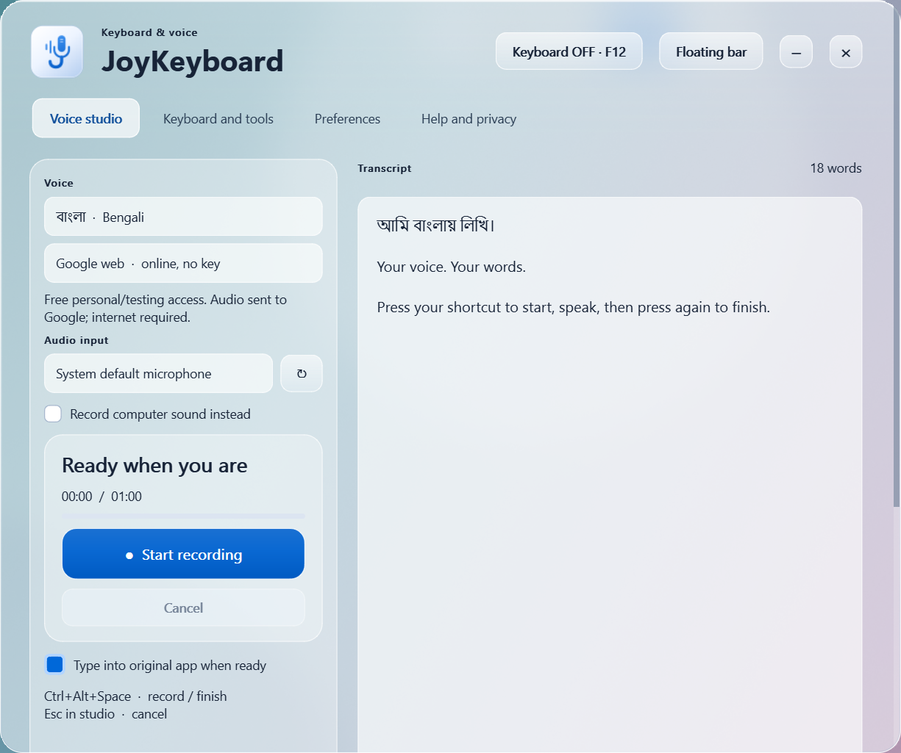

# JoyKeyboard 0.4.5

**Developed by Sohaib Islam Joy** · [Facebook](https://www.facebook.com/sohaib.islam1997)

Windows Bengali/English keyboard and voice studio. Independently built; no NMS Kontho proprietary code, dictionaries, branding, credentials or license checks reused. Original J/microphone icon included.




## Install with one EXE

Open **dist/0.4.5/JoyKeyboard-Setup.exe**. Quit any older running copy before opening the installed app. One installer EXE, no ZIP or separate Python/runtime download. Installs for your Windows account without administrator permission, with Start Menu shortcut and an uninstaller. Python, libraries, dictionaries and multilingual Whisper Base/Tiny weights are included. Runtime files stay installed, avoiding extraction at every launch. Allow roughly 1 GB free installation space. Settings and learned words stay in `%LOCALAPPDATA%/JoyKeyboard`; uninstall preserves them.

Installer's **Select Additional Tasks** page offers **Start JoyKeyboard when I sign in to Windows**, checked by default, plus an optional desktop shortcut. Change startup any time under **Preferences → Appearance & startup**. Both use the same HKCU Run entry. Startup displays the idle floating bar; it never starts recording automatically. Windows Startup Apps policies can override startup. App uses one instance per user.

Target: **Windows 10 1809+ / Windows 11, Intel/AMD x64**. ARM, 32-bit Windows, Windows 7, macOS/Linux and every old CPU are not certified. Audio devices/drivers required for recording; offline models need additional memory and supported CPU instructions. The EXE is unsigned, so Windows may display an unknown-publisher warning.

## Floating bar

The app opens as a **384 × 48 logical-pixel floating bar**, always on top. Drag the dotted grip to move it; its position is remembered and recovered onto a connected screen. Click the language/layout selector to choose Bangla/English speech and a keyboard layout. The keyboard icon toggles typing; **Speak / Finish** controls recording. Cancel, timer and level appear while recording; clickable word suggestions appear while composing.

The **three-dot menu** reaches every tool, speech engine, microphone/computer audio choice, Unicode/Bijoy output, automatic typing, Preferences and privacy help. Click the **Joy icon** for the full workspace. Closing the workspace returns to the bar and keeps drafts; **Quit JoyKeyboard** in the bar/tray menu exits with unsaved-draft checks. The minus button hides the idle bar to the notification area; click the tray icon to restore it. Errors/transcript feedback appear in an expandable strip with Copy/Open controls.

**Clear Glass interface:** Real per-pixel transparency with Windows compositor blur, neutral silver tint and fine reflective edges. Desktop colors show through bar and workspace; foreground text/icons stay crisp at 100% bar opacity. Select **Theme → Clear Glass** from the three-dot menu or **Preferences → Appearance & startup → Theme**. Clear Glass is the default for new profiles; old Dark Glass preferences migrate automatically. Existing Light Glass preferences stay opaque. All six tools and inputs use translucent layers; native menus remain opaque for readability. Screenshots above show the actual app over an owned test backdrop, not a wallpaper built into the app.

**Light Glass** remains available for fully opaque surfaces and lower graphics cost. Windows blur availability varies by OS/settings/driver; unavailable native blur falls back to a denser translucent tint. Uses an optional Windows composition entry point with failure handling, no new library, desktop-capture loop, refraction shader or animation timer. This is a Windows glass treatment inspired by Apple, not Apple's proprietary renderer. Foreground opacity remains independently adjustable (70/80/90/100%); 100% keeps controls crisp while Clear Glass material stays see-through. Text contrast depends on what's behind the window; choose Light Glass for consistently opaque surfaces.

The workspace has a draggable title (double-click maximize/restore), minimize/close-to-bar buttons and a lower-right resize grip. Closing still preserves drafts and returns to the floating bar. Native file dialogs retain Windows appearance.


## Download from GitHub

[Latest installer and source release](https://github.com/sohaibjoy0178/joykeyboard/releases/latest). Download **JoyKeyboard-Setup.exe** and install; no ZIP extraction needed. `SHA256SUMS.txt` accompanies the installer. Repository is private, so sign in with an authorized GitHub account. EXE is attached to GitHub Releases; source/build scripts remain in Git history. Large offline model weights are included in the installer and excluded from Git source history.

## Resource use

Idle controls resize/repaint only when state changes. Large dictionaries load on first suggestion request, so idle and voice-only use avoid their memory cost. Native numerical thread pools are bounded by default; offline recognition uses at most two CPU threads (one on one/two-core PCs). Google online is the lighter transcription option; local speech-pause detection still runs during capture. Offline recognition requires more RAM/CPU and models stay loaded for reuse. Models stay on disk until needed.

On this Ryzen 9 Windows 11 development PC, visible-idle ten-second checks dropped working set from roughly **195 to 126 MiB**, private committed memory from **879 to 72 MiB**, and CPU from **9.5% to 0.5% of one core**. These are idle results, not low-end-device certification or recording/transcription memory limits. See `VERIFICATION.md` and `artifacts/idle-*.json`.

## Voice typing

### Custom global shortcut

Default **Ctrl+Alt+Space** works across normal Windows apps while JoyKeyboard is running, even with its bar hidden. Press once to start, speak, press again to stop and transcribe into the original field. Recognition finishes before text appears; pressing during recognition does not start another recording. Microphone stops on Finish. Automatic speech-pause finishing stays available; disable it in Preferences when you want only the shortcut to finish.

Customize: **bar menu → Voice shortcut** (or **Preferences → Voice shortcut**). Click the shortcut box, press your chosen combination, then **Apply shortcut**. Example: **Ctrl+Alt+V**. Current shortcut appears in bar tooltips, studio and tray. **Reset default** restores Ctrl+Alt+Space. Choice is saved across restarts. Editing the box never starts recording.

Uses native Windows global registration, without key polling. Held keys do not repeatedly toggle. Already-used/reserved combinations show an inline error and keep the previous working shortcut; saving failures roll back. Use Ctrl/Alt/Shift plus one supported key, or F9–F11/F13–F24 alone. F12 stays the keyboard toggle; bare F1–F8 stay candidate selection. Windows-key chords and multi-step sequences are not supported. Windows secure desktops/lock screens are outside this feature. Elevated/custom fields may still block text insertion; transcript stays available. Closing JoyKeyboard releases its shortcut.

**Automatic Finish is enabled by default.** After speech, a pause of about 1.5 seconds finishes the recording and starts transcription; you do not need to click Finish. Recognition takes additional time. The microphone then stops: click Speak or use the shortcut to start the next phrase. This release handles one phrase per recording, without continuous background listening.

Turn **Finish on speech pause** off in the bar's three-dot menu or Preferences when you want longer thinking pauses. Holding Right Ctrl still waits for release. Speech detection runs locally using the already bundled Silero VAD, without a key/download. Ten seconds with no detected speech discards the recording locally. If detection fails to load, the bar explains that manual Finish is needed; your recording remains available. Manual Finish, shortcut and Cancel still work.

1. Allow desktop microphone access in Windows Privacy settings.
2. Choose Bangla/English with the bar's language selector. Microphone and engine choices are in its three-dot menu or Voice studio.
3. Focus the destination text field. Click **Speak** or press **Ctrl+Alt+Space**, speak, then pause to finish automatically. You can also click **Finish** or press the shortcut again. Optional **hold Right Ctrl** is in Preferences. Recording stops at 60 seconds. The bar's cancel control discards recording; Esc also cancels while studio is focused.
4. Review the transcript, copy/save it, or let **Type into original app when ready** insert it. Disable automatic typing for review first. If destination changes or rejects insertion, the transcript remains available.

**Bangla recommendation: Google online.** Three public FLEURS Bengali samples produced readable Bengali in testing, with recognition errors. Offline Base and Small produced poor Bangla, including incorrect scripts/hallucinations. Do not rely on offline Bangla for important text. Tiny/Base remain available as free local engines, particularly for English. No engine guarantees perfect recognition; review names, numbers and punctuation.

| Engine | Key / cost | Behavior |
| --- | --- | --- |
| Google web, experimental | No user API key or app subscription | Sends recorded audio to Google. Internet required; access can change, be limited or stop. No production service guarantee. |
| Offline Whisper | No key or per-minute service charge | Base and Tiny included. Runs on CPU, without audio upload. Optional Small download; larger does not guarantee better Bangla. |

No voice API key needed for these integrated modes. Official Google Cloud Speech-to-Text is a separate service, not integrated; its credentials cannot be entered here. Optional Gemini text assistance uses a separate user-supplied session key and may incur provider charges. Never embed shared secrets in a distributed EXE.

**Record computer sound instead** captures default Windows speaker through WASAPI loopback. It records all audio playing through that output; stop unrelated playback first. Spoken phrase replacements, Bengali digits and Unicode/Bijoy output are under Preferences. Bijoy needs a compatible legacy Bengali font in the destination; Unicode recommended for modern apps.

## Keyboard and tools

**0.4.1 typing fixes:** remapped/on-screen virtual-key input now goes through Bangla composition. JoyKeyboard marks only its own generated keystrokes to prevent feedback loops; other input is no longer discarded merely because Windows marks it injected. Fast typing no longer mistakes delayed caret movement from an inserted word for a user caret change; native editors get a bounded settling interval. Dictionary loading/matching runs in a separate worker so word insertion does not wait for suggestions. Choose **Bangla phonetic**, enable the keyboard icon or **F12**, focus Notepad/browser, type `ami banglay likhi`, then **Space** to insert `আমি বাংলায় লিখি`. Pending word appears in the floating bar until Space/Enter or a candidate selection commits it. Unicode recommended for modern apps.

- **F12** toggles system-wide keyboard mode. Starts off every launch. Layouts: Bengali phonetic, English, Probhat and Bengali InScript. Fixed layouts cover printable/Shift positions on a US physical keyboard; AltGr/keypad extensions absent.
- Composition appears in floating toolbar. **Space/Enter/punctuation commits** the word; **F1-F8** chooses candidate. This uses a Windows hook, not TSF IME registration. Turn mode off before passwords; custom/browser secure fields may not be detected.
- Licensed Bengali/English dictionaries contain 504,240 entries. Suggestions combine frequency, personal usage and bounded correction. Next-word prediction learns committed word transitions locally.
- Words manager edits personal words/snippets, imports/exports validated JSON and shows recent committed words. Invalid original files protected against silent overwrite.
- Converter supports Unicode/Bijoy. Common-word coverage tested; arbitrary mixed Latin/legacy text and every font variant not guaranteed.
- Screen keys compose Bengali/Latin text for insertion, without system Ctrl/Alt shortcut simulation.
- DocPad opens/saves UTF-8 text, finds/replaces and exports PDF, with unsaved-edit protection.
- Optional Gemini sends only text explicitly submitted, with an in-memory API key. No key bundled or saved. Review results before insertion.

Protected/elevated apps, games and custom editors may reject simulated typing. Native target/control/caret checks reduce accidental delivery; they cannot identify every browser field. Clipboard changes only on explicit Copy. Keep keyboard mode off when unused.

## Privacy and local data

Audio recorded only on request, not saved automatically. Google mode uploads clips to Google; offline mode stays local. No silent cloud fallback. **Committed words, recent word history and transitions are retained locally** in `keyboard-data.json` when app closes. Successful voice transcripts also feed local learning. Avoid committing sensitive text if you do not want it in local learning. Words tab provides import/export/history controls. Preferences: `settings.json`; user model downloads: `models/` under same local data directory.

## Build from source

Requires Windows x64 and Python 3.12 x64:

```powershell
py -3.12 -m venv .venv
.\.venv\Scripts\python.exe -m pip install -r requirements.txt
.\.venv\Scripts\python.exe main.py
powershell -ExecutionPolicy Bypass -File .\build.ps1 -SkipInstall
powershell -ExecutionPolicy Bypass -File .\build-installer.ps1 -SkipInstall
```

`build-installer.ps1` requires Inno Setup 6.7+ ([official download](https://jrsoftware.org/isdl.php)); pass `-IsccPath` if not detected. It validates icons, runs tests, clean-builds installed runtime under `dist/0.4.5/JoyKeyboard/` and compiles the single `JoyKeyboard-Setup.exe`. Keep the runtime folder for debugging; distribute only the setup EXE. Original `build.ps1` still builds an optional portable one-file app at `dist/JoyKeyboard.exe`. Build on Windows x64; no cross-compilation. `assets/models/` must contain supplied Base/Tiny files; obtain unmodified files from repositories in `assets/models/SOURCES.txt` when rebuilding without weights. Dictionary provenance: `assets/keyboard/` and `KEYBOARD-SOURCES.md`.

## Licenses and replacement

Third-party notices, model MIT license, original layout files and dictionary attribution bundled in the installed `_internal` folder under `licenses/` and `assets/`, and available in this source project. See **KEYBOARD-SOURCES.md** for parser/layout/dictionary source URLs and licenses, including CC-BY-SA data. Original icon artwork: `assets/joykeyboard.svg`.

PySide6/Qt and FFmpeg shared libraries retain upstream LGPL terms. This source project/build specification let recipients rebuild/relink with compatible modified libraries; one-file extraction contents are temporary and replaced on launch. Reverse engineering library modifications for debugging permitted under applicable licenses. Obtain exact corresponding upstream sources matching `requirements-lock.txt`:

- [Qt LGPL guidance](https://www.qt.io/licensing/open-source-lgpl-obligations), [Qt sources](https://download.qt.io/archive/qt/), [PySide sources](https://download.qt.io/official_releases/QtForPython/)
- [FFmpeg sources](https://ffmpeg.org/download.html#get-sources), [PyAV wheel recipes](https://github.com/PyAV-Org/pyav-wheels)
- [Whisper MIT sources/models](https://github.com/openai/whisper), [faster-whisper](https://github.com/SYSTRAN/faster-whisper)

See `VERIFICATION.md` for executed checks and boundaries. No claim of exact Kontho feature parity or universal PC compatibility.
